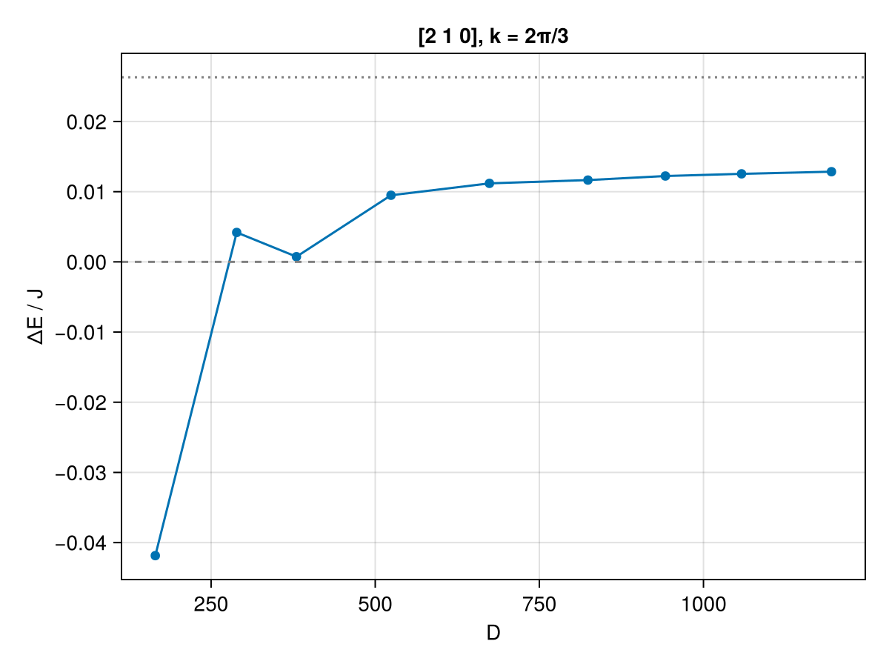
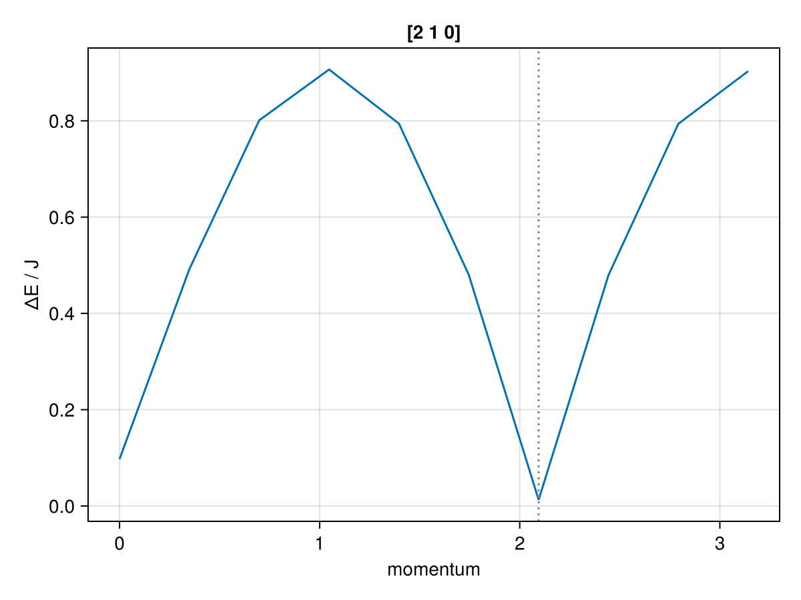

```@meta
EditURL = "../../../../../examples/excitations/su3-heisenberg/main.jl"
```

[](https://mybinder.org/v2/gh/QuantumKitHub/MPSKit.jl/gh-pages?filepath=dev/examples/excitations/su3-heisenberg/main.ipynb)
[](https://nbviewer.jupyter.org/github/QuantumKitHub/MPSKit.jl/blob/gh-pages/dev/examples/excitations/su3-heisenberg/main.ipynb)
[](https://minhaskamal.github.io/DownGit/#/home?url=https://github.com/QuantumKitHub/MPSKit.jl/examples/tree/gh-pages/dev/examples/excitations/su3-heisenberg)

# The SU(3) Heisenberg chain

The spin-1 Heisenberg chain has a gapped, symmetry-protected topological ground state, the Haldane phase.
In this example we study what happens when the SU(2) symmetry of the spins is promoted to SU(3), following [devos2022](@cite).
Every site of the chain carries the fully symmetric ``[3 0 0]`` irrep of SU(3), which is ten-dimensional, and neighbouring sites are coupled by the SU(3)-invariant Heisenberg interaction

```math
H = J ∑_{⟨i,j⟩} ∑_{a=1}^{8} Tᵃᵢ Tᵃⱼ
```

where the ``Tᵃ`` are the eight generators of SU(3).
This is the direct analogue of the spin-1 chain, with the three generators of SU(2) replaced by the eight generators of SU(3).

Just as in the [Haldane gap](@ref "The Haldane gap") example, imposing the full non-abelian symmetry block-diagonalizes every tensor, so that a modest number of variational parameters captures a large bond dimension.
The SU(3) Clebsch–Gordan coefficients are provided by [SUNRepresentations.jl](https://github.com/QuantumKitHub/SUNRepresentations.jl), whose `SU3Irrep` sectors plug directly into TensorKit.

!!! warning "First-run cost"
    SUNRepresentations.jl computes Clebsch–Gordan coefficients on demand, and caches them both in memory and on disk.
    The first time a coefficient is needed, this computation can be slow.

To follow this example you need the following packages:

````julia
using MPSKit, TensorKit, SUNRepresentations, CairoMakie
````

For reproducibility of this page, we fix the seed of the random number generator:

````julia
using Random
Random.seed!(4321);
````

## The model

Each site carries the ``[3 0 0]`` irrep, which we specify through its highest weight.

````julia
I300 = SU3Irrep(3, 0, 0)
Vphys = Vect[SU3Irrep](I300 => 1)
dim(I300)
````

````
10
````

To build the interaction, we use that it is diagonal in the total charge ``c`` of a bond.
Writing ``C₂ = ∑ₐ TᵃTᵃ`` for the quadratic Casimir, we have

```math
∑ₐ Tᵃᵢ Tᵃⱼ = ½ (C₂(c) - 2 C₂([3 0 0])).
```

SUNRepresentations.jl provides the quadratic Casimir as `casimir(2, irrep)`, normalized such that the fundamental ``[1 0 0]`` has ``C₂ = 4/3``.

````julia
casimir(2, SU3Irrep(1, 0, 0)), casimir(2, I300)
````

````
(4//3, 6//1)
````

The nearest-neighbour term is then a single operator that acts as a scalar on each fusion channel of ``[3 0 0] ⊗ [3 0 0]``.
We construct it by filling in the blocks, one for every total charge ``c``:

````julia
function su3_heisenberg(Vphys; J = 1.0)
    c2_site = casimir(2, SU3Irrep(3, 0, 0))
    SS = zeros(ComplexF64, Vphys ⊗ Vphys ← Vphys ⊗ Vphys)
    for (c, data) in blocks(SS)
        coupling = (casimir(2, c) - 2 * c2_site) / 2
        for i in axes(data, 1)
            data[i, i] = J * coupling
        end
    end
    return InfiniteMPOHamiltonian(SS)
end

H = su3_heisenberg(Vphys)
````

````
1-site InfiniteMPOHamiltonian(ComplexF64, Rep[SU₃]) with maximal dimension 10:
| ⋮
| (((0, 0, 0)=>1) ⊞ ((2, 1, 0)=>1) ⊞ ((0, 0, 0)=>1))
┼─[1]─ ((3, 0, 0) => 1)
│ (((0, 0, 0)=>1) ⊞ ((2, 1, 0)=>1) ⊞ ((0, 0, 0)=>1))
| ⋮

````

The product ``[3 0 0] ⊗ [3 0 0]`` decomposes into four irreps, and the antiferromagnetic coupling favours the channels with the lowest Casimir:

````julia
for (c, n) in directproduct(I300, I300)
    coupling = (casimir(2, c) - 2 * casimir(2, I300)) / 2
    println("$c:\t dim = $(dim(c)),\t coupling = $coupling")
end
````

````
Irrep[SU₃]((4, 2, 0)):	 dim = 27,	 coupling = -2//1
Irrep[SU₃]((5, 1, 0)):	 dim = 35,	 coupling = 0//1
Irrep[SU₃]((6, 0, 0)):	 dim = 28,	 coupling = 3//1
Irrep[SU₃]((3, 3, 0)):	 dim = 10,	 coupling = -3//1

````

## Ground state

The ``[3 0 0]`` irrep has trivial triality, so that, as for the spin-1 chain, a translation-invariant state with a single-site unit cell is allowed.
The physical charge then cannot change the triality of the virtual spaces, so all virtual charges must have the same triality.
Here we use virtual charges with trivial triality, which give the lowest variational energy.
We start from a small virtual space, and optimize a random initial state with VUMPS:

````julia
Vvirt = Vect[SU3Irrep](
    SU3Irrep(0, 0, 0) => 3,
    SU3Irrep(2, 1, 0) => 6,
    SU3Irrep(3, 0, 0) => 3,
    SU3Irrep(3, 3, 0) => 3,
    SU3Irrep(4, 2, 0) => 2,
)
ψ₀ = InfiniteMPS([Vphys], [Vvirt])
vumps = VUMPS(; maxiter = 400, tol = 1.0e-10, verbosity = 0)
ψ, envs, info = find_groundstate(ψ₀, H, vumps)
E₀ = real(expectation_value(ψ, H, envs))
````

````
-2.5735056524313213
````

## Excitations

On top of the ground state, we compute excitations with the quasiparticle ansatz.
Following [devos2022](@cite), we look for the lowest excitations in the adjoint ``[2 1 0]`` sector, which has its minimum at momentum ``k = 2π/3``.

````julia
sector = SU3Irrep(2, 1, 0)
Es, _ = excitations(H, QuasiparticleAnsatz(), 2π / 3, ψ, envs; sector)
ΔE = real(Es[1])
````

````
-0.04185666026343908
````

The excitation energy comes out negative, which would mean that there are states below the ground state.

!!! warning "Excitation energies are not variational"
    The quasiparticle ansatz returns the energy of the excited state *relative to the ground-state energy*.
    The ground state itself is only approximated, and its energy ``E₀`` lies above the exact one.
    Any error in ``E₀`` therefore directly shifts the excitation energies, and they are not an upper bound on the true gap.
    In particular, a gap that is small compared to the error in ``E₀`` can come out too small, or even negative.

The remedy is to improve the ground state.
Instead of guessing a larger virtual space, we let `changebonds` with `OptimalExpand` grow the bond dimension, by adding the directions that contribute the most to a two-site update of the converged state.
Here `truncrank` counts the total dimension that is added to each bond, including the dimension of the SU(3) irreps.
Every expanded state is then reconverged with VUMPS, and we recompute the excitation energy at ``k = 2π/3``.

````julia
expand = OptimalExpand(; trunc = truncrank(150))
Ds = [dim(left_virtualspace(ψ, 1))]
E₀s = [E₀]
ΔEs = [ΔE]
for step in 1:8
    global ψ, envs = changebonds(ψ, H, expand, envs)
    global ψ, envs, info = find_groundstate(ψ, H, vumps, envs)
    Es_step, _ = excitations(H, QuasiparticleAnsatz(), 2π / 3, ψ, envs; sector)
    push!(Ds, dim(left_virtualspace(ψ, 1)))
    push!(E₀s, real(expectation_value(ψ, H, envs)))
    push!(ΔEs, real(Es_step[1]))
end
[Ds E₀s ΔEs]
````

````
9×3 Matrix{Float64}:
  165.0  -2.57351  -0.0418567
  289.0  -2.58456   0.00418946
  380.0  -2.58558   0.00073655
  524.0  -2.58673   0.00949052
  674.0  -2.58715   0.0111844
  824.0  -2.58736   0.0116534
  942.0  -2.58746   0.0122323
 1058.0  -2.58757   0.0125425
 1195.0  -2.58769   0.0128488
````

````julia
fig = Figure()
ax = Axis(fig[1, 1]; xlabel = "D", ylabel = "ΔE / J", title = "[2 1 0], k = 2π/3")
scatterlines!(ax, Ds, ΔEs)
hlines!(ax, [0.0]; color = :gray, linestyle = :dash)
hlines!(ax, [0.0263]; color = :gray, linestyle = :dot)
fig
````



As the bond dimension grows, the ground-state energy decreases, and the excitation energy turns positive already after the first expansion.
Apart from a dip at the second expansion, where VUMPS does not fully converge within `maxiter`, it then increases steadily.
It is still increasing at the largest bond dimension used here, and remains below the value ``ΔE / J = 0.0263`` reported in [devos2022](@cite) (dotted line).
Resolving this small gap therefore requires an even larger bond dimension.

Finally, we compute the dispersion relation on top of the largest ground state, scanning half of the Brillouin zone.

````julia
kspace = range(0, π, 10)
Es, _ = excitations(H, QuasiparticleAnsatz(), kspace, ψ, envs; sector, verbosity = 0)

fig = Figure()
ax = Axis(fig[1, 1]; xlabel = "momentum", ylabel = "ΔE / J", title = "[2 1 0]")
lines!(ax, kspace, vec(real.(Es)))
vlines!(ax, [2π / 3]; color = :gray, linestyle = :dot)
fig
````



The dispersion has its minimum at ``k = 2π/3``, where [devos2022](@cite) locates the gap of this model.

---

*This page was generated using [Literate.jl](https://github.com/fredrikekre/Literate.jl).*

