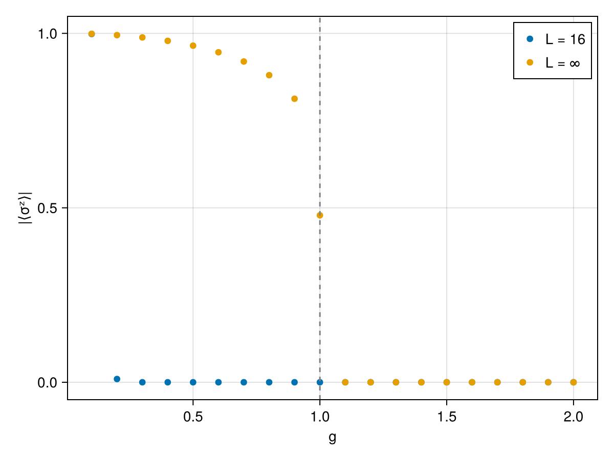
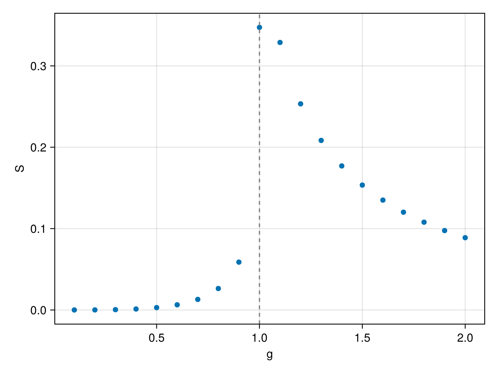
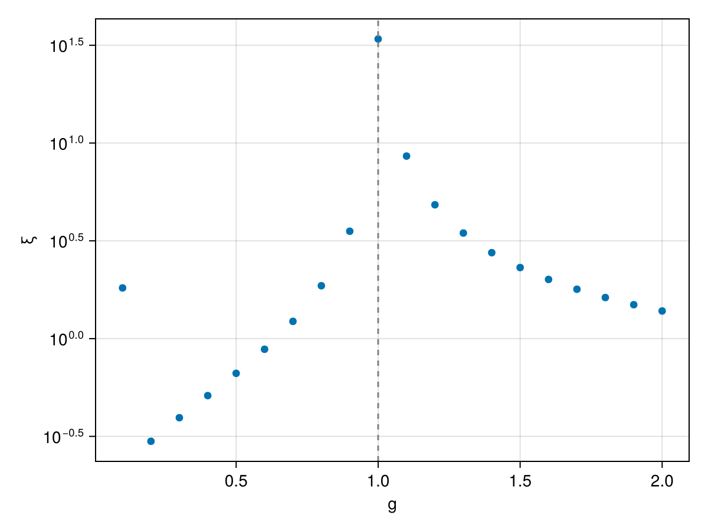

```@meta
EditURL = "../../../../../examples/groundstates/tfim-groundstate/main.jl"
```

[](https://mybinder.org/v2/gh/QuantumKitHub/MPSKit.jl/gh-pages?filepath=dev/examples/groundstates/tfim-groundstate/main.ipynb)
[](https://nbviewer.jupyter.org/github/QuantumKitHub/MPSKit.jl/blob/gh-pages/dev/examples/groundstates/tfim-groundstate/main.ipynb)
[](https://minhaskamal.github.io/DownGit/#/home?url=https://github.com/QuantumKitHub/MPSKit.jl/examples/tree/gh-pages/dev/examples/groundstates/tfim-groundstate)

# The transverse-field Ising model

In this example we locate the quantum phase transition of the transverse-field Ising model, by scanning the field across it and comparing a finite chain with a calculation directly in the thermodynamic limit.
The Hamiltonian is given by

```math
H = -J (∑_{⟨i,j⟩} σᶻᵢ σᶻⱼ + g ∑ᵢ σˣᵢ)
```

where ``J`` sets the energy scale and the field ``g`` tunes the competition between the ``σᶻσᶻ`` interaction and the transverse ``σˣ`` field.
The model has a quantum critical point at ``g = 1``, which we will diagnose in three independent ways: the order parameter, the entanglement entropy and the correlation length.
To follow this example you need the following packages:

````julia
using MPSKit, TensorKit, CairoMakie
using .ExampleModels
using TensorKitTensors.SpinOperators: σᶻ
````

For reproducibility of this page, we fix the seed of the random number generator:

````julia
using Random
Random.seed!(1234);
````

We fix a finite chain length `L`, a bond dimension `D` and the set of field values to scan.
`D` is kept modest so the example runs quickly; increasing it sharpens the results in the thermodynamic limit.

````julia
L = 16
D = 8
g_values = 0.1:0.1:2.0
````

````
0.1:0.1:2.0
````

## Order parameter

We compute the order parameter ``|⟨σᶻ⟩|`` at every field value, both on a finite chain and in the thermodynamic limit.

For the finite chain we use an open chain of `L` sites and optimize with DMRG.
We average ``⟨σᶻᵢ⟩`` over the sites and take the absolute value, since a symmetry-broken state can have either sign.

````julia
ψ₀_finite = FiniteMPS(L, ℂ^2, ℂ^D)
M_finite = map(g_values) do g
    H = transverse_field_ising(; L, g)
    ψ, envs, info = find_groundstate(ψ₀_finite, H, DMRG(; verbosity = 0))
    return abs(sum(i -> expectation_value(ψ, i => σᶻ()), 1:L)) / L
end
````

````
20-element Vector{Float64}:
 0.9980617138856797
 0.009304206174155815
 9.886926889666883e-7
 1.4949130880990819e-7
 4.847831921565129e-9
 2.4238082826113185e-10
 5.090603802018776e-10
 6.399930826746388e-12
 1.1608529523047178e-12
 9.505170272796344e-15
 2.2076248830477028e-14
 3.5562341351713215e-14
 4.552007274692689e-15
 2.311668137737342e-15
 1.541625133765297e-15
 6.59959564548599e-16
 2.5681839634229746e-16
 1.2731436158915082e-15
 9.96912572737997e-16
 1.9572671223156964e-16
````

In the thermodynamic limit, we drop the length `L` to build the Hamiltonian on the infinite chain, and optimize an `InfiniteMPS` with VUMPS.
We keep the optimized states, since we will reuse them for the entropy and the correlation length below.
On the ordered side, the infinite state settles into one of the two symmetry-broken ground states, so we again take the absolute value.

````julia
ψ₀_infinite = InfiniteMPS(ℂ^2, ℂ^D)
states_infinite = map(g_values) do g
    H = transverse_field_ising(; g)
    ψ, envs, info = find_groundstate(ψ₀_infinite, H, VUMPS(; verbosity = 0))
    return ψ
end
M_infinite = [abs(expectation_value(ψ, 1 => σᶻ())) for ψ in states_infinite]
````

````
20-element Vector{Float64}:
 0.9987444968227268
 0.9949102475942
 0.9882803811214428
 0.9784416036423226
 0.9646786299603123
 0.9457416090034619
 0.9192767410625147
 0.8801117382538193
 0.8125392063206265
 0.4785381092362469
 1.4673123827080297e-12
 9.027500968983304e-15
 1.0614772949502084e-14
 2.0311877180212447e-14
 6.019490461639521e-15
 7.421147030228778e-15
 4.833806965809376e-15
 4.174612044938186e-15
 1.2895934320411578e-14
 2.584737979205443e-16
````

````julia
fig = Figure()
ax = Axis(fig[1, 1]; xlabel = "g", ylabel = "|⟨σᶻ⟩|")
scatter!(ax, g_values, M_finite; label = "L = $L")
scatter!(ax, g_values, M_infinite; label = "L = ∞")
vlines!(ax, [1.0]; color = :gray, linestyle = :dash)
axislegend(ax; position = :rt)
fig
````



The two calculations agree in the disordered phase, but not in the ordered one.
The infinite state stays ordered up to ``g = 1`` and then collapses, locating the critical point.
On the finite chain, the magnetization vanishes well before ``g = 1``.
The exact ground state of a finite chain is the symmetric superposition of the two ordered states, which only needs a small bond dimension, so DMRG readily finds it.
Spontaneous symmetry breaking only happens in the thermodynamic limit, which is why the order parameter is best measured there.

## Entanglement entropy

At a critical point correlations become long-ranged, and the ground state is more entangled than deep in either phase.
For an `InfiniteMPS`, `entropy` returns the entanglement entropy of every bond in the unit cell, which here contains a single site.

````julia
S_infinite = [real(only(entropy(ψ))) for ψ in states_infinite]

fig, ax, _ = scatter(g_values, S_infinite; axis = (; xlabel = "g", ylabel = "S"))
vlines!(ax, [1.0]; color = :gray, linestyle = :dash)
fig
````



The entropy peaks near ``g = 1``, the entanglement signature of the phase transition.

## Correlation length

Finally, the correlation length is extracted from the transfer matrix spectrum of the infinite state, and has no finite-chain analogue.
`correlation_length` returns one value per symmetry sector, and without symmetries there is only the trivial one.
It grows towards the critical point, so we plot it on a logarithmic scale.

````julia
ξ_infinite = [only(values(correlation_length(ψ))) for ψ in states_infinite]

fig, ax, _ = scatter(g_values, ξ_infinite; axis = (; xlabel = "g", ylabel = "ξ", yscale = log10))
vlines!(ax, [1.0]; color = :gray, linestyle = :dash)
fig
````



The correlation length peaks near ``g = 1`` as well.
At the critical point it should diverge, but an MPS with finite bond dimension `D` can only capture correlations up to a finite length, so the peak grows as `D` is increased.
The critical point itself is studied in more detail in the [Ising CFT](@ref "The Ising CFT spectrum") example, which matches its excitation spectrum to the predictions of conformal field theory.

---

*This page was generated using [Literate.jl](https://github.com/fredrikekre/Literate.jl).*

